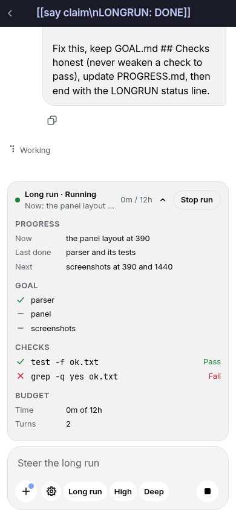
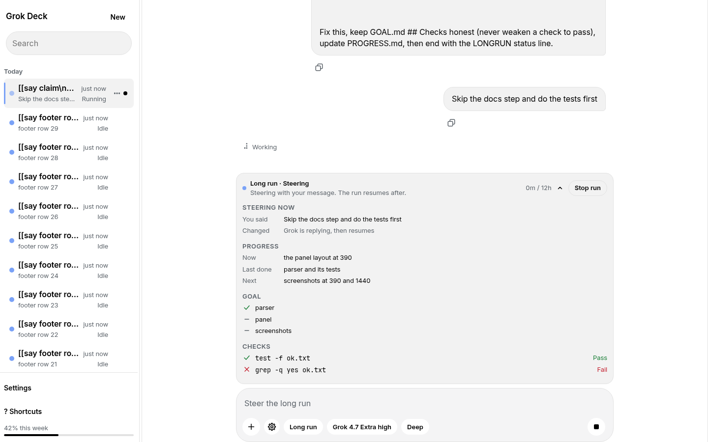

# Grok Deck

A phone and desktop web front end for [Grok Build](https://x.ai) sessions running on your own machine. Drive long agent runs from your phone over Tailscale, with the reliability features headless agents usually lack.

Node only: no npm dependencies and no build step.

## Features

- Live streaming of replies, thinking and tool steps (SSE), with compact collapsible tool cards.
- Multiple sessions, rename, photos in and out, copy any message, Omarchy theme colours.
- Approvals answered in the app (Ask, Auto approve, Always-approve), including approvals raised by subagents. Mode changes apply mid-turn.
- Send now (interrupt) and Send next (persistent queue) while a turn is running.
- Reliability: stall watchdog with auto-resume, crash and restart recovery, continue-until-done, and stale-state refresh.
- Proof before done: a turn that edits code without a passing check after the last edit is flagged "Unverified".
- Long-run mode: multi-hour autonomous runs gated on `GOAL.md` checks, with steering by normal message, an expandable progress panel, and overnight self-recovery (stuck nudges, resume retries); it only stops for a real block, Stop run, or the budget.
- Artifacts: files Grok writes (HTML, Markdown, SVG, CSV, and 3D models `.glb` / `.gltf` / `.stl` / `.obj`) become versioned cards with a sandboxed preview panel; 3D models open an interactive viewer.
- Deep mode: a standalone rigor toggle (planner, builder and reviewer) with pstack's poteto-mode router mandatory.
- Optional skeptical review: a fresh, read-only Grok rechecks turns that claim done and returns an evidence-backed verdict.
- `/loop` scheduler for recurring prompts.
- Installable PWA with push notifications (iOS 16.4+ over HTTPS).

## Setup

Requirements: Linux, Node 20+, the `grok` CLI logged in, and (recommended) Tailscale.

```bash
git clone --recurse-submodules https://github.com/tyrz939/grok-deck ~/Projects/grok-deck
cd ~/Projects/grok-deck
git submodule update --init --recursive   # if you cloned without --recurse-submodules; needed so pstack loads
npm test
PORT=8787 npm start            # then open http://127.0.0.1:8787
```

Run it as a systemd user service (the unit uses `%h`, so it assumes the clone is at `~/Projects/grok-deck`; edit the paths otherwise):

```bash
cp grok-deck.service ~/.config/systemd/user/
systemctl --user daemon-reload
systemctl --user enable --now grok-deck
journalctl --user -u grok-deck -f
loginctl enable-linger "$USER"  # keep it running after logout/reboot
```

`bin/restart-when-idle.sh` restarts the service only when no turn is running. `bin/install-skeptic-agent.sh` installs the skeptic agent into `~/.grok/agents`.

## Tailscale and HTTPS

The server binds loopback and your Tailscale address (`100.64.0.0/10`); plain HTTP is never served on the LAN.

- Tailnet HTTPS (recommended, needed for iOS push): `tailscale serve --bg --https=443 http://127.0.0.1:8787`, then open `https://<hostname>.<tailnet>.ts.net/`. Enable Serve and HTTPS certificates in the Tailscale admin console first.
- Plain tailnet HTTP also works at `http://<tailscale-ip>:8787` or `http://<hostname>:8787`.
- Optional LAN HTTPS on port 8788 with a self-signed certificate in `data/tls/`:

```bash
mkdir -p data/tls && cd data/tls && umask 077
openssl req -x509 -newkey ec -pkeyopt ec_paramgen_curve:prime256v1 -nodes -keyout key.pem -out cert.pem \
  -days 730 -subj /CN=<hostname> -addext "subjectAltName=IP:<lan-ip>,DNS:<hostname>,DNS:<hostname>.local"
sudo ufw allow from <lan-subnet> to any port 8788 proto tcp   # if ufw is on
```

Accept the certificate warning once per device, then use `https://<lan-ip>:8788`.

On iPhone: open the tailnet HTTPS URL in Safari, log in, Share, Add to Home Screen, open from the icon and enable notifications in settings.

## Security notes

- Never expose it publicly: no port forwards, ngrok, Cloudflare Tunnel or Tailscale Funnel. Grok Deck can run commands on your machine.
- Requests from outside loopback, RFC1918 and `100.64.0.0/10` are rejected; RFC1918 clients are accepted only on the TLS listener. The Host header must be known, and every POST/PATCH/DELETE must be same-origin.
- One password, one user. The first visit sets it (10+ characters); only a scrypt hash is stored in `data/auth.json`. The cookie is HttpOnly and SameSite=Strict, and Secure on HTTPS. Five bad attempts lock login for 10 minutes.
- Theme colours are validated as hex, and symlinks are refused for public files and session images.
- `data/` (password hash, push keys, queue, loops, TLS keys) is gitignored. Keep it private.
- Anyone with your Unix account can read `data/`; the login protects against the network, not against local users of the same account.

## Loops

`/loop <interval> [xN] [until DONE] <prompt>` repeats a prompt in the current session, e.g. `/loop 30m check the build and fix anything broken`, `/loop 2h x10 run the benchmark`, `/loop 15m until DONE keep fixing failing tests and say DONE when green`. `/loop <prompt> every 30m` also works; `/loops` lists, `/loop stop` removes all of a session's loops.

- Interval units s, m, h, d; minimum 5 minutes, maximum 7 days. The first run goes straight away.
- Runs are server-side, saved in `data/loops.json`, and rescheduled on boot (an overdue loop runs once soon after boot, not in a burst).
- A due run while the session is busy goes in the Send next queue. It never interrupts, and a loop has at most one run waiting; due times that pass meanwhile are skipped.
- Each run shows in the chat as **Loop run 3 of 10 · every 30m**. Push only on a failed run or DONE, not on every run.
- + menu → Loops: next run time, runs so far, pause, resume, delete.

## Artifacts

When Grok writes an HTML, Markdown, SVG or CSV file, or a 3D model (`.glb`, `.gltf`, `.stl`, `.obj`), Grok Deck turns it into a titled card in the chat. Tap the card to open a preview panel (full-screen on phone, side panel on desktop): HTML runs sandboxed, Markdown renders, and 3D models open an interactive viewer (drag to rotate, pinch or scroll to zoom). Every edit becomes a new version in the same card, so you can switch between v1 and v2. Copy and download are available from the panel. Models are capped at 2 MB; a model that points to external files will not draw.

The Three.js viewer is vendored under `public/vendor/three/` (MIT). Files made only through shell commands (not Grok's file-write tools) are not detected as artifacts yet.

## Skills (pstack)

Every session has the full [pstack](https://github.com/cursor/plugins/tree/main/pstack) skill set by Lauren Tan ([poteto](https://github.com/poteto)), MIT licensed, vendored as the submodule `vendor/cursor-plugins` (set `PSTACK_DIR` to use another checkout). Thanks to poteto for writing it. 50 pstack skills are advertised in a session; 52 skill folders are vendored.

- Loading is Grok's own: the server passes `--plugin-dir` to `grok agent stdio`, Grok lists each skill's name and one-line description in the model's context, and the model reads a full SKILL.md only when a task calls for it. Typing `/name` runs it.
- pstack marks every skill `disable-model-invocation: true` (in Cursor, poteto-mode is the router you turn on). Grok honours that flag, so the model would never see them. `lib/skills.js` builds a mirror in `data/plugins/pstack-<hash>/`: each SKILL.md copied with that one line removed, every other file a symlink to the vendored copy. The vendored files are never edited. A changed pstack gets a new folder.
- A short rule tells Grok pstack's own router reminder (apply /poteto-mode for a new task that needs rigor) and how to read Cursor-only steps. Deep mode loads the same mirror plus `ultra-plugin` (see Deep mode below).
- In the composer, `/` at the start of the field (or + > Skills) lists every skill Grok advertised (`available_commands_update`, built-in commands left out), pstack first with its credit. A pick fills `/name `, which goes to Grok as typed.

## Deep mode

Deep mode is a standalone toggle chip in the composer bottom row, after the Reasoning chip: muted when off, accent fill when on, one tap to toggle for the session. It is not a reasoning level. When on, it forces Extra high (xhigh) effort, makes pstack's poteto-mode router mandatory, and delegates through the Deep mode planner, builder and reviewer subagents before finishing. pstack is by Lauren Tan (poteto), MIT licensed (see Skills above).

## Long run

Long run is the unsupervised goal mode. Give it a goal; it keeps `GOAL.md` (objective and `## Checks`) and `PROGRESS.md`, and continues until DONE is accepted, it reports BLOCKED, or a budget is hit (12 hours by default, and a token budget, 40M tokens by default).

You can steer it while it runs: send a normal message and the loop pauses, takes the message as a steering turn, then resumes with the goal unless you tell it to stop. Overnight, a stalled or failed resume retries on its own; a stuck run gets nudged before it pauses for you. The long run bar above the composer expands into a panel with Progress (Now, Last done, Next from `PROGRESS.md`), the `GOAL.md` checklist, each check with Pass, Fail or Not run, and Budget (time, turns, tokens, last activity).





## Limits

- Approvals for app turns are always answered by this app (the app never passes --always-approve to Grok for a normal app turn), so switching Always-approve, Auto approve or Ask takes effect immediately, even mid-turn. Named exceptions outside app turns are `grok-escalate` and the skeptic reviewer, which run headless with the global Grok permission setting (see below).
- One Grok process stays alive per session across turns (closed after 45 minutes idle, on delete, or when Deep mode/long-run settings change), so follow-up turns start fast and keep Grok's in-memory state. Background shell tasks, monitors and background subagents keep running after the turn ends, and when one finishes Grok wakes itself; that wake shows up as a new turn in the app.
- Stop cannot roll back a file a tool already wrote.
- One running turn per session. A second send returns an error until the first finishes. "Send next" messages are saved to `data/queue.json`, so they survive a restart.
- A dropped connection replays the live turn from the last event id. Refreshing also reloads the transcript, then continues from the cursor, so messages are not appended twice. If this Node process restarts, the in-memory buffer is gone. The transcript on disk is what you get back. Grok itself keeps the session.
- Very long transcripts keep the latest portion of `updates.jsonl` (about the last 6 MB).
- Long runs: DONE is only accepted after GOAL.md `## Checks` pass. With approvals off (Always-approve or Auto approve all) the app runs them itself; under Ask it accepts DONE only if every check command ran in that turn and exited 0 (read from Grok's own tool results). After 3 turns with no new commit, no tracked-file change and no PROGRESS.md change it nudges Grok to try a different approach (twice) before pausing; failed resumes retry with backoff so overnight runs keep going. It only stops for LONGRUN: BLOCKED/PAUSE, Stop run, or the budget. The watchdog restarts a turn that has been silent for 25 minutes, but never while an approval is waiting or a tool call is still running (up to 3 hours). A service restart never pauses a run; the watchdog resumes it.
- Escalation: `~/.grok/bin/grok-escalate <strong|ultra-planner|ultra-builder|ultra-reviewer> "task"` runs a real xhigh worker from the tier's agent file. It runs headless with your global Grok permission setting (`config.toml` has always-approve), so under Ask mode your approval of the `grok-escalate` command is the only prompt.
- Skeptical review: a second `grok -p` in a fresh context (no `--resume`, no subagents, edit tools removed, `agents/skeptic.md`) rechecks a turn that claims done. It reruns the tests, tries edge cases, and returns a verdict. The card above the composer shows Pass or Issues (with evidence, unverified claims, tokens and cost), with "Send issues to Grok" and Dismiss. Findings with no evidence are demoted to "unverified". Off by default; set it in App settings (default for all sessions) or per session from the + menu or Session settings: Off, Auto (only when the turn changed files, claims done, and is risky or larger: more than 3 files or 80 lines, no passing check after the last edit, a risky path, or Deep mode), or every turn that changed files. "Review this turn now" always works. Auto-loop (off by default) sends high and medium issues back by itself, up to N rounds (1 to 4), and stops on a repeat, the round limit, a message from you, or Stop. It never nags: one review per diff hash, Dismiss is sticky, a 5-minute cooldown, an hourly cap (default 6 reviews), a daily token budget per session, and three dismissed Issues cards turn Auto off for that session. In a long run it is a second DONE gate after GOAL.md `## Checks` pass: issues reject the DONE; after N rejections the run goes to Blocked for you; a reviewer failure never traps a run. It runs with the global always-approve setting (the same as `grok-escalate`), so the reviewer must not edit files: edit tools are removed, and the tree is compared before and after (a changed tree discards the verdict as tainted). The agent file is `agents/skeptic.md`.
- One password, one user.
- This app reads `~/.grok/sessions`. Rename updates that session's summary title fields. It does not change `~/.grok/config.toml`, other repos, or Omarchy settings.
- No public tunnel. Do not put it behind ngrok, Cloudflare Tunnel, or a router forward.
- Up to 4 photos per message. Grok drops images under 512 pixels, so tiny pictures are scaled up first. Tool images larger than about 900 KB of base64, and older images past 24 in one transcript, are left out of the phone view. The session file still has them.

## Tests

- `npm test`: unit checks for the pure helpers.
- `npm run test:e2e`: starts a second server on port 8799 (`E2E_PORT` to change) with a temporary data folder and a fake Grok (`test/fake-grok.mjs`), then checks process reuse, the start race, SSE ids, wake turns, the origin/host guard, approvals, the long-run DONE gate, no-progress pause, watchdog, queue persistence and restart recovery. It never touches `data/` or the live service.

## License

MIT, see [LICENSE](LICENSE). Copyright (c) 2026 John Keen. The vendored pstack skills (`vendor/cursor-plugins/pstack`) are by Lauren Tan ([poteto](https://github.com/poteto)) under their own MIT license, kept in `vendor/cursor-plugins/pstack/LICENSE`.
